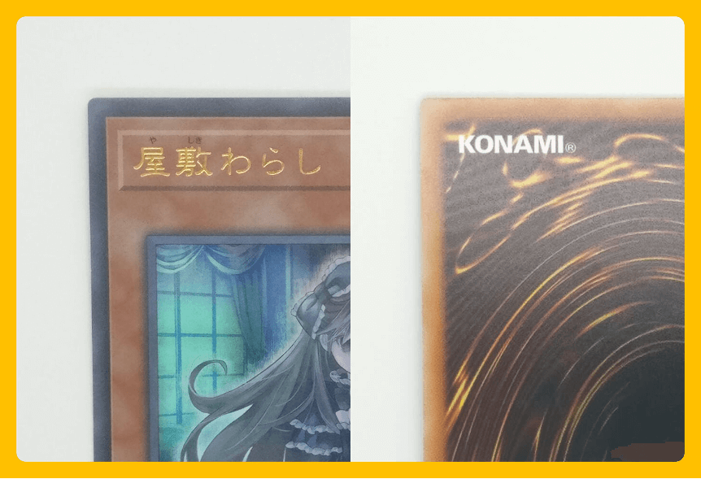
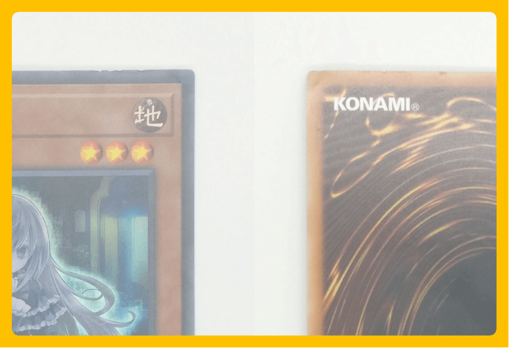
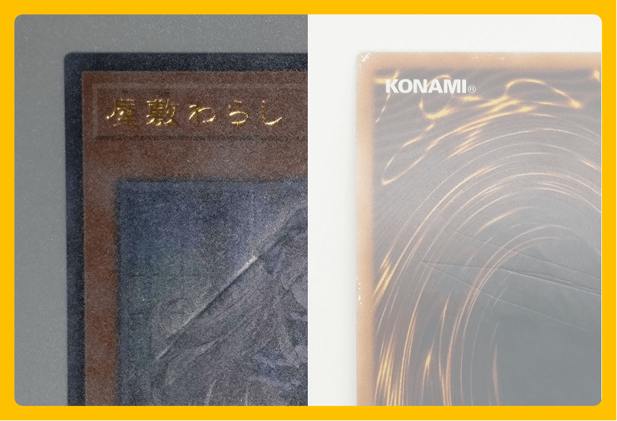
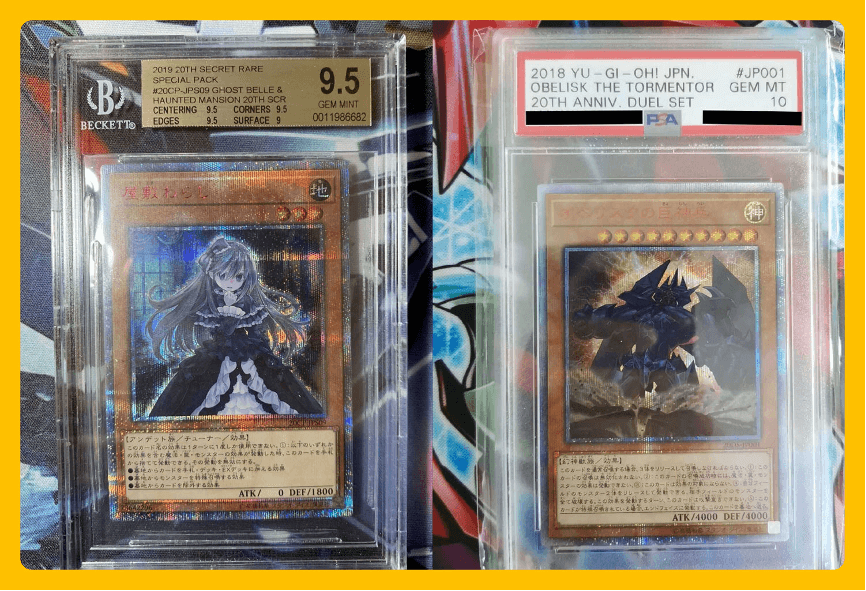

# 卡牌品相定义

## 卡品纠纷参考

1. 因商品版本、品牌方及生产工艺不同，品相判定标准可能存在轻微差异。
2. 交易纠纷以客服介入后的核实结果为参考。
3. 购买方应录制商品开箱视频，作为发生交易纠纷时的凭证。
4. 商品图片、版本、评级机构、评级分数及具体瑕疵以商品详情页展示为准。

## 一、流通品相

可能存在以下轻微、不明显且不影响正面观赏和整体卡面的痕迹：

- 出厂切割导致的轻微毛边，出厂印刷的墨点或印刷线；
- 卡牌正常受潮导致的不明显轻微弯曲；
- 卡背轻微污渍，且污渍面积小于背面面积的 1/2；
- 流通过程中出现的轻微痕迹；
- 卡背轻微白点、白边、白角；
- 轻微脱色、划痕等暗伤不超过两处；
- 其他不影响正面观赏和整体卡面的轻微、不明显痕迹。

## 二、瑕疵品相

存在以下任一情形的，通常视为瑕疵品相：

- 肉眼易见三处或以上的白角、白边、正反面划痕、翘边或翘角；
- 非自然受潮变形，包括折痕；
- 明显的白角、白边、正反面划痕、翘边、翘角、凹凸坑或压痕；
- 较为明显的脱色；
- 卡背污渍面积大于背面面积的 1/2。

如覆盖区域较大且存在多处相同瑕疵，则按损伤品相判定。瑕疵品相卡片整体无折损，适宜摆本。

## 三、损伤品相

存在以下明显损伤或痕迹的，通常视为损伤品相：

- 大面积白边、白点；
- 多处划痕或深刻划痕、折痕；
- 大而明显、不规则或影响卡面的痕迹；
- 严重角损、卡面被裁切；
- 液体浸湿痕迹、污渍或墨水；
- 贯穿卡面的损伤；
- 人为修复痕迹；
- 严重碎裂、撕裂或修剪（卡片上的切割痕迹）；
- 食物、饮料或其他明显痕迹。

## 四、评级卡（流通品相）

评级卡默认为流通品相，可能存在以下正常情况：

- 卡壳带有轻微气泡；
- 卡壳上有轻微划痕；
- 卡壳上有轻微、可擦拭的污渍；
- 评级机构装裱商品后，非人为二次原因导致卡壳内含有灰尘、碎屑或颗粒物。

评级分数由对应评级机构评定，评级卡壳的上述情况不等同于卡内卡牌损伤。

## 五、全新未拆

商品保持原厂封装，尚未拆封。原厂封装状态、包装版本及商品内容以商品详情页图片和描述为准。

## 六、已拆盒

商品外包装已拆开。内部卡牌或物品的具体状态、版本、数量及品相，以商品详情页图片、描述和品相标识为准。
